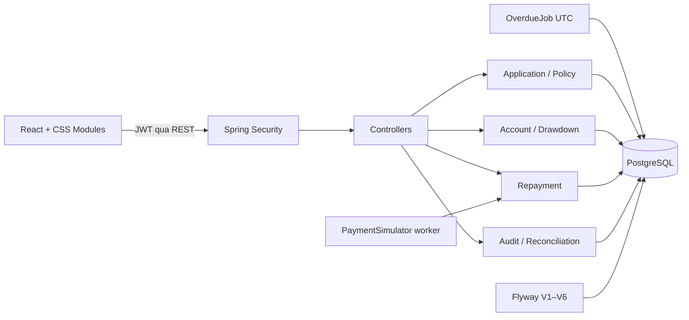
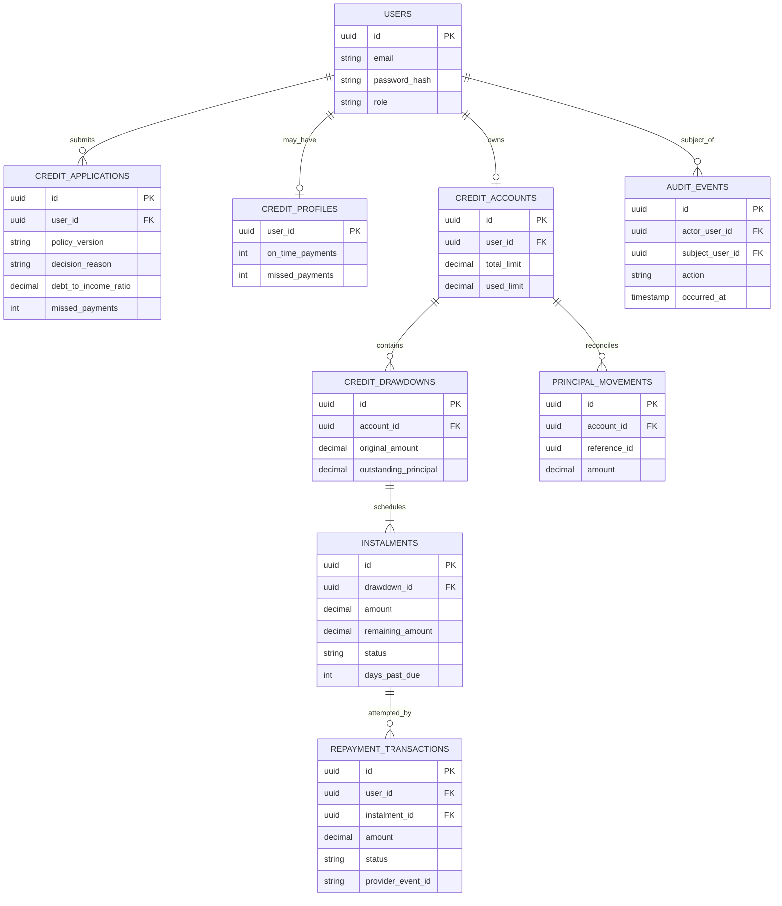
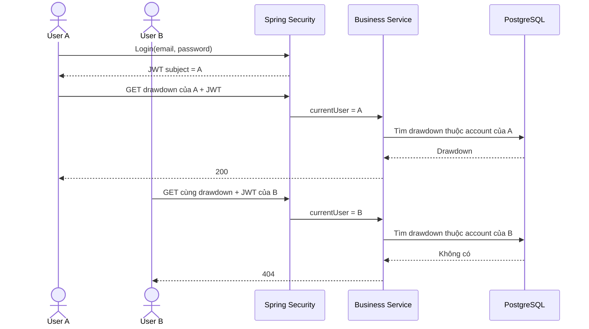
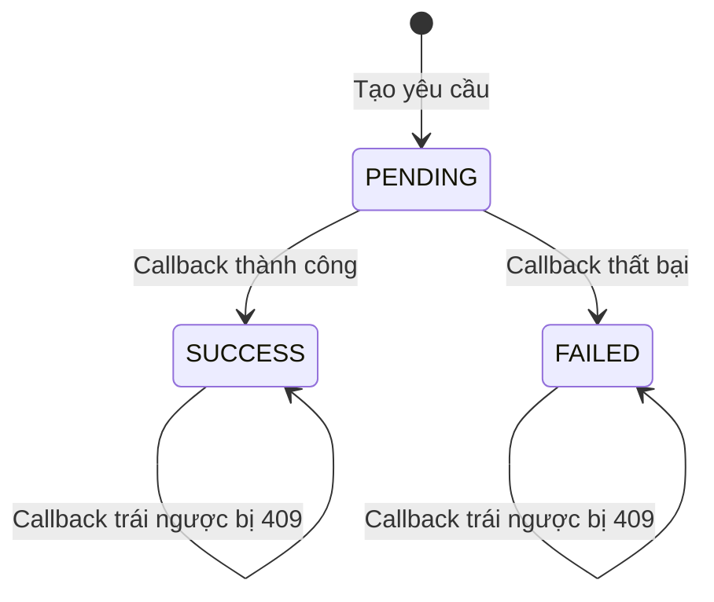
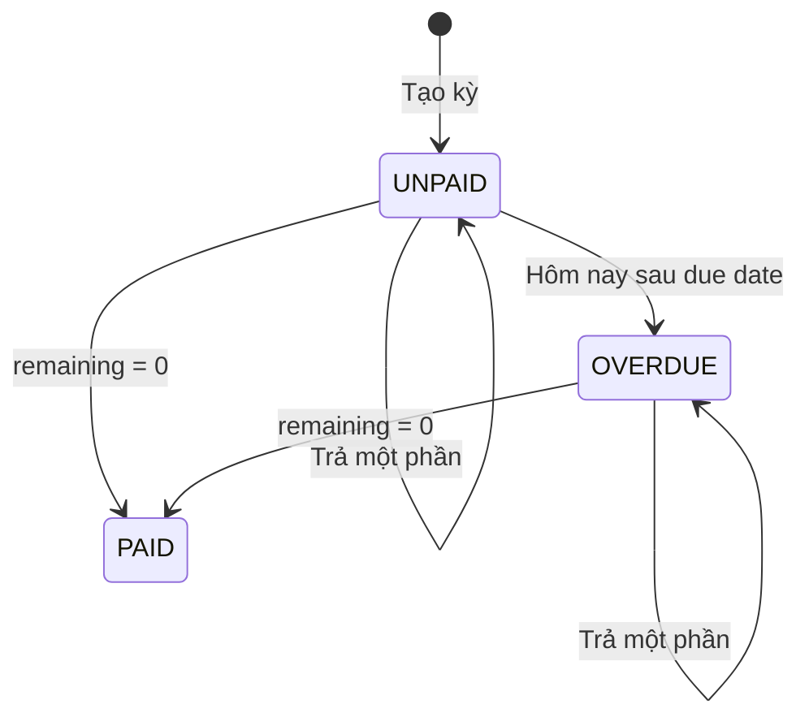
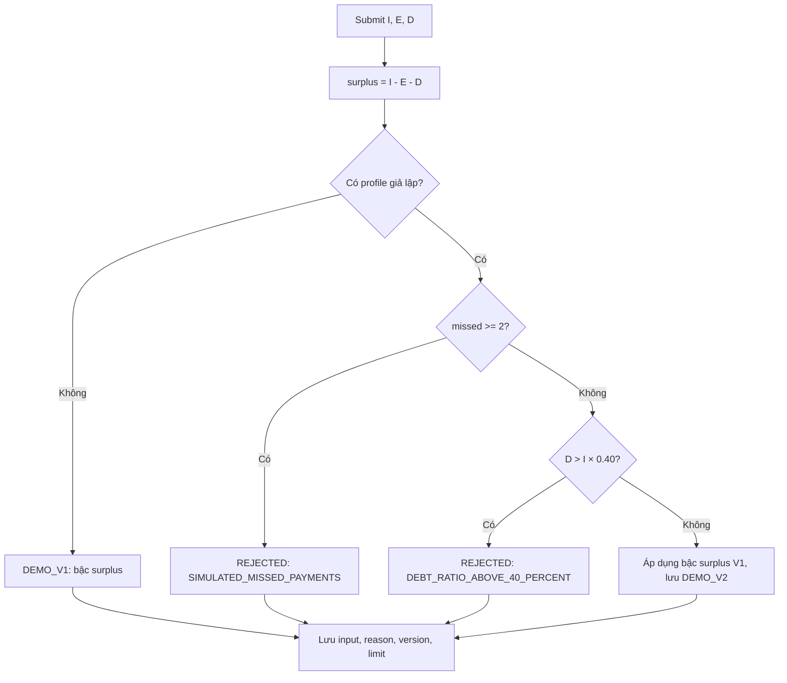
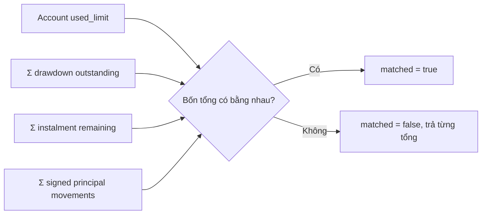

# Mini Lending mở rộng — phân tích nghiệp vụ và kiến trúc

> Phạm vi: bản mở rộng sau MVP, tại commit `161c151` trên `develop`. Các ngưỡng, lịch sử trả nợ và payment provider đều là **dữ liệu giả lập**. Tài liệu này phản ánh code hiện có, đồng thời chỉ rõ chỗ chưa đạt mức hệ thống cho vay thực.

Đọc [MVP_BUSINESS_LOGIC.md](MVP_BUSINESS_LOGIC.md) trước nếu cần nền tảng về hạn mức, drawdown và lịch bốn kỳ. Kế hoạch triển khai ở [EXTENSION_PLAN.md](EXTENSION_PLAN.md).

## 1. Vì sao mở rộng

MVP chứng minh phép tính số dư nhưng chỉ chạy cho một người và coi thanh toán luôn thành công ngay lập tức. Bản mới thêm năm năng lực: **tài khoản/phân quyền, thanh toán bất đồng bộ, trả một phần/quá hạn, thẩm định có lý do, bút toán/đối soát/audit**. Frontend React dùng CSS Modules để đăng nhập, xem trạng thái thanh toán và nhập số tiền trả một phần.

| Trục nghiệp vụ  | MVP                             | Bản mở rộng                                          |
| --------------- | ------------------------------- | ---------------------------------------------------- |
| Chủ thể         | UUID demo cố định               | Nhiều user; JWT xác định chủ tài nguyên              |
| Quyết định      | `DEMO_V1` theo surplus          | Tùy chọn `DEMO_V2` với lịch sử giả lập và debt ratio |
| Thanh toán      | Ghi `SUCCESS` và đổi số dư ngay | Tạo `PENDING`, sau đó `SUCCESS` hoặc `FAILED`        |
| Kỳ trả          | Một giao dịch trả đủ            | Nhiều lần trả một phần; theo dõi remaining           |
| Quá hạn         | Không có                        | Job UTC cập nhật `OVERDUE` và số ngày                |
| Kiểm soát số dư | So sánh trong test              | Bút toán append-only, API đối soát và audit          |

## 2. Sơ đồ thành phần và ranh giới tin cậy



`/api/auth/register` và `/api/auth/login` là public. Các business endpoint đọc subject UUID từ JWT đã xác thực. `/api/admin/**` cần role `ADMIN`. PaymentSimulator là tiến trình trong cùng Spring Boot app, không phải cổng thanh toán bên ngoài. PostgreSQL là nơi lưu trạng thái giao dịch và số dư; callback, bút toán và audit của một settlement cùng transaction.

## 3. Dữ liệu và migration



| Flyway | Thay đổi chính                                                                 | Dữ liệu cũ                                                                               |
| ------ | ------------------------------------------------------------------------------ | ---------------------------------------------------------------------------------------- |
| V1     | Sáu bảng MVP, seed user demo                                                   | Tạo schema ban đầu                                                                       |
| V2     | Email, password hash, role; khóa idempotency repayment theo user               | Backfill `user_id` từ kỳ → drawdown → account; password demo được bootstrap lúc app chạy |
| V3     | Repayment trở thành payment attempt `PENDING/SUCCESS/FAILED`; nhiều attempt/kỳ | `requested_at` của giao dịch cũ lấy từ `paid_at`                                         |
| V4     | `remaining_amount`, `days_past_due`, `OVERDUE`                                 | Kỳ `PAID` nhận remaining 0; kỳ còn mở nhận original amount                               |
| V5     | Profile giả lập và snapshot/ratio trên application                             | Application V1 giữ các cột snapshot null                                                 |
| V6     | Principal movements, audit events, trigger append-only                         | Backfill drawdown dương và repayment SUCCESS âm                                          |

Mỗi migration chạy một lần theo `flyway_schema_history`. Sửa nội dung migration đã phát hành sẽ làm checksum không khớp; thay đổi tiếp theo phải tạo V7 trở lên. `spring.jpa.hibernate.ddl-auto=validate` kiểm tra entity phù hợp schema, không tự sửa bảng.

## 4. Tài khoản, quyền và cách ly dữ liệu

Đăng ký lưu email không phân biệt hoa thường, mật khẩu BCrypt và role `CUSTOMER`. Login cấp JWT HMAC có subject là UUID, role và thời hạn một giờ. Demo user có credential local; admin chỉ được seed khi cấu hình `ADMIN_EMAIL` và `ADMIN_PASSWORD`.



Application, account, drawdown, instalment, payment và history đều được scope bằng chủ tài khoản ở service/repository. `401` là chưa xác thực; `403` là đã xác thực nhưng thiếu quyền admin; `404` cho ID tài nguyên không thuộc user, tránh tiết lộ sự tồn tại của tài nguyên người khác. Khóa idempotency của repayment độc nhất theo `(user_id, key)`.

**Giới hạn:** đây là auth cho simulator, chưa có xác minh email, reset mật khẩu, refresh token, rate limit hay quản lý phiên. Frontend giữ JWT trong `sessionStorage`; lựa chọn này đơn giản cho demo nhưng cần xem xét XSS và thiết kế cookie an toàn nếu triển khai thật.

## 5. Thanh toán bất đồng bộ và idempotency

### State machine



POST `/api/instalments/{id}/repay` trả `202` và tạo bản ghi `PENDING`. Tại thời điểm này **không** giảm nợ hay hoàn hạn mức. Request lặp cùng user/key/instalment và amount đã xác định trả cùng payment ID. Một request mới cho cùng kỳ khi còn attempt PENDING bị `409`.

Worker quét attempt đủ tuổi (mặc định 5 giây), chọn outcome giả lập từ UUID với tỷ lệ thất bại cấu hình mặc định 10%, rồi gọi cùng `settle` mà endpoint admin dùng. Frontend polling `GET /api/payments/{id}`; nếu chưa rõ kết quả mạng, nó giữ nguyên idempotency key. Sau `FAILED`, người dùng thử lại bằng key mới.

```mermaid
sequenceDiagram
    actor U as Người dùng
    participant UI as React
    participant API as Repayment API
    participant DB as PostgreSQL
    participant W as Simulator hoặc admin callback
    U->>UI: Yêu cầu trả 30.25
    UI->>API: POST repay + Idempotency-Key
    API->>DB: Khóa account, kiểm tra kỳ và pending
    API->>DB: INSERT payment PENDING + audit
    API-->>UI: 202 + payment ID
    UI->>API: GET payments/{id}
    API-->>UI: PENDING
    W->>API: settle(id, outcome, eventId)
    API->>DB: Khóa account; refresh payment
    alt SUCCESS
        API->>DB: Giảm remaining, outstanding, used
        API->>DB: INSERT bút toán âm + audit
    else FAILED
        API->>DB: Chỉ đổi status + audit
    end
    API->>DB: Lưu outcome và unique eventId
    UI->>API: GET payments/{id}
    API-->>UI: SUCCESS hoặc FAILED
```

Khóa account serialize các settlement của cùng chủ. Sau khi lấy khóa, service refresh entity vì có thể đã chờ một callback khác. Với attempt đã terminal, cùng outcome và cùng `provider_event_id` trả lại kết quả; outcome khác hoặc event khác trả `409`. DB có unique index trên event ID và `(event_type, reference_id)` của ledger. Vì thay đổi số dư, status, ledger và audit cùng transaction, lỗi giữa chừng rollback toàn bộ.

Một giới hạn của mã hiện tại: khi retry cùng key nhưng **bỏ amount** ở request mới, service chưa so sánh đầy đủ payload với lần request có amount rõ ràng trước đó. Đây là chỗ cần bổ sung fingerprint của request để bảo đảm key không được tái sử dụng cho payload khác.

**Giới hạn:** simulator không ký webhook và không tích hợp Stripe. Worker nằm trong app, quét polling và không có hàng đợi vận hành riêng; lỗi xử lý được thử lại ở lần quét sau. Đây là mô phỏng đặc tính kết quả đến sau, không phải hệ thống thu tiền thật.

## 6. Trả một phần và nợ quá hạn

Mỗi kỳ có `amount` gốc và `remaining_amount`. Chỉ kỳ còn mở có sequence thấp nhất trong **từng drawdown** được yêu cầu trả. Request có thể không gửi amount (trả hết phần còn lại) hoặc gửi `0 < amount <= remaining_amount`, tối đa hai chữ số thập phân. Không tự chia tiền sang kỳ sau và không có lãi/phí; toàn bộ tiền vào gốc.

Khi callback `SUCCESS`:

```text
instalment.remaining_amount -= payment.amount
drawdown.outstanding_principal -= payment.amount
account.used_limit -= payment.amount
account.available_limit = account.total_limit - account.used_limit
```

Kỳ thành `PAID` chỉ khi remaining bằng 0. Drawdown thành `PAID_OFF` chỉ khi outstanding bằng 0. `FAILED` giữ nguyên cả ba số dư. Ví dụ drawdown 400 tạo bốn kỳ 100; trả 30,25 thành công cho kỳ đầu thì kỳ đó còn 69,75, used/outstanding từ 400 xuống 369,75.



`OverdueJob` chạy mỗi ngày lúc 00:05 UTC, lấy ngày từ `Clock`, cập nhật `days_past_due = max(0, today - due_date)` cho kỳ còn mở. Trả một phần không xóa trạng thái quá hạn. Vì daysPastDue được lưu, giá trị có thể cũ cho tới lần job tiếp theo; nếu cần số ngày chính xác theo từng request, có thể tính từ due date khi đọc.

## 7. Thẩm định có giải thích

Nếu không có `credit_profile`, ứng dụng dùng `DEMO_V1` như MVP. Người dùng có thể nhập số lần trả đúng hạn và số lần chậm trả **giả lập**; profile được lưu riêng và `DEMO_V2` áp dụng ở lần submit tiếp theo. Xóa profile trả về V1 cho quyết định mới. Application cũ vẫn giữ snapshot và policy version lúc nó được thẩm định.



Debt ratio hiển thị là `D / I`, làm tròn bốn chữ số thập phân; nếu `I=0`, code dùng 0 khi `D=0`, ngược lại dùng 1. **So sánh ngưỡng dùng số tiền gốc** `D > I × 0,40`, không dùng ratio đã làm tròn, tránh duyệt nhầm giá trị ngay trên ngưỡng. Thứ tự lý do: hai lần chậm trả được xét trước, rồi debt ratio, rồi bậc surplus. Quy tắc này do simulator đặt ra; không thể dùng nó để kết luận khả năng trả nợ của một cá nhân thật.

## 8. Bút toán, đối soát và audit

Một drawdown ghi movement **dương** bằng số tiền sử dụng; một payment `SUCCESS` ghi movement **âm** bằng số gốc đã trả. Không ghi movement khi payment `PENDING/FAILED`. Mỗi event có một reference ID độc nhất. Trigger PostgreSQL chặn UPDATE/DELETE trên `principal_movements` và `audit_events`; sửa sai trong tương lai cần bút toán bù, không sửa dòng cũ.



API admin `GET /api/admin/reconciliation` chạy phép so sánh trên từng account tại thời điểm gọi:

```text
used_limit
  = SUM(drawdown.outstanding_principal)
  = SUM(instalment.remaining_amount)
  = SUM(principal_movements.amount)
```

Audit ghi subject user, actor user (có thể null khi worker chạy), hành động, loại/ID tài nguyên, chi tiết và thời điểm cho thay đổi application, account, profile, drawdown và payment. Customer đọc lịch sử của mình; admin có endpoint đọc theo user. Đây là lịch sử nghiệp vụ, **chưa** bao phủ mọi lần đăng nhập hoặc mọi lần đọc dữ liệu.

Đối soát hiện chạy **theo yêu cầu của admin**, chưa có lịch tự chạy/cảnh báo hay quy trình sửa lệch. Bút toán hiện chỉ ghi **principal movement**, chưa là kế toán kép với tài khoản đối ứng, tiền lãi, phí hay số dư tiền mặt. Vì app không phát sự kiện ra broker/hệ thống khác, chưa có transactional outbox. Khi thêm publish bên ngoài, nên ghi outbox trong cùng transaction rồi có worker phát và consumer idempotent.

## 9. Bất biến và ranh giới transaction

| Nghiệp vụ       | Khóa/transaction                                                                | Bất biến sau commit                                                                |
| --------------- | ------------------------------------------------------------------------------- | ---------------------------------------------------------------------------------- |
| Nộp hồ sơ       | Khóa user; lưu application và account cùng transaction                          | Một user tối đa một account; hồ sơ bị từ chối có thể nộp lại                       |
| Drawdown        | Khóa account; tạo drawdown, bốn kỳ, ledger và audit cùng transaction            | `used <= total`; key trùng không tăng nợ lần hai                                   |
| Payment request | Khóa account; tạo PENDING và audit                                              | Không đổi used/outstanding/remaining trước SUCCESS; một pending/kỳ                 |
| Settlement      | Khóa account; kiểm tra event; cập nhật kỳ/drawdown/account/payment/ledger/audit | SUCCESS giảm cả ba số dư một lượng; FAILED giảm 0; callback lặp không giảm lần hai |
| Overdue job     | Transaction cập nhật kỳ còn mở                                                  | Kỳ PAID không thành OVERDUE                                                        |

Các kiểm tra `CHECK`, foreign key và unique index trong PostgreSQL là lớp bảo vệ bổ sung cho validation của Java. Việc dùng cả JPA và JDBC cho ledger yêu cầu flush JPA trước khi JDBC chèn movement tham chiếu drawdown vừa tạo; code đã làm điều đó.

## 10. Trade-off và phương án khác

| Quyết định hiện tại                  | Vì sao phù hợp simulator                               | Phương án khi tăng độ thực tế                                                              |
| ------------------------------------ | ------------------------------------------------------ | ------------------------------------------------------------------------------------------ |
| JWT HMAC, seed demo/admin bằng env   | Chạy local nhanh, dễ kiểm thử quyền                    | Secret quản lý tập trung, refresh/revoke token, MFA/admin provisioning, email verification |
| Worker polling trong Spring Boot     | Demo được trạng thái đến trễ mà không cần hạ tầng khác | Queue + webhook đã xác thực, retry có backoff và dead-letter                               |
| Failure dựa trên hash UUID           | Tái lập được lỗi demo mà không có provider             | Outcome do provider thật quyết định; lưu raw event và chữ ký đã kiểm chứng                 |
| Row lock trên account                | Dễ chứng minh không hoàn hạn mức hai lần               | Tối ưu contention; tách aggregate/optimistic lock khi lưu lượng cao                        |
| Remaining và daysPastDue lưu trên kỳ | Đọc UI nhanh, job đơn giản                             | Tính daysPastDue khi đọc, hoặc event-driven projection nếu cần độ mới tức thời             |
| Profile do user tự nhập              | Minh họa explainability                                | Dữ liệu kiểm chứng được, policy governance, fairness/validation và kiểm toán mô hình       |
| Signed principal movement            | Đối soát dư nợ dễ hiểu                                 | Double-entry ledger, reversal entry, reconciliation định kỳ và cảnh báo                    |
| Không có outbox                      | Không có publish ra ngoài để mất sự kiện               | Transactional outbox khi tích hợp broker/notification/analytics                            |

## 11. Kiểm chứng và các giới hạn còn lại

Suite backend dùng PostgreSQL Testcontainers để kiểm tra hai user truy cập chéo, `401/403`, drawdown đồng thời, payment `PENDING/SUCCESS/FAILED`, callback trùng và callback đồng thời, trả một phần đến cent, ngày quá hạn bằng fixed `Clock`, ngưỡng/snapshot policy và đối soát lệch. Frontend qua format check và production build. Có smoke test HTTP với user mới: `APPROVED → drawdown 400 → PENDING → SUCCESS 30,25 → used 369,75`.

Đây vẫn là simulator: không có hợp đồng vay, giải ngân tiền, thu tiền thật, lãi/phí, xử lý gian lận, KYC, báo cáo tín dụng, kiểm soát tuân thủ hay vận hành production. Khi thay mô phỏng bằng hệ thống thật, cần thiết kế lại các ranh giới này trước khi dùng cho khách hàng.
