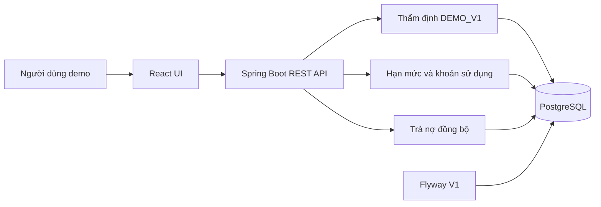
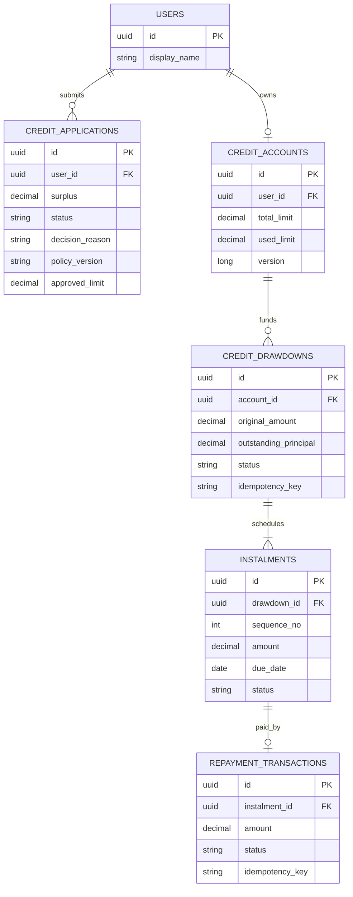
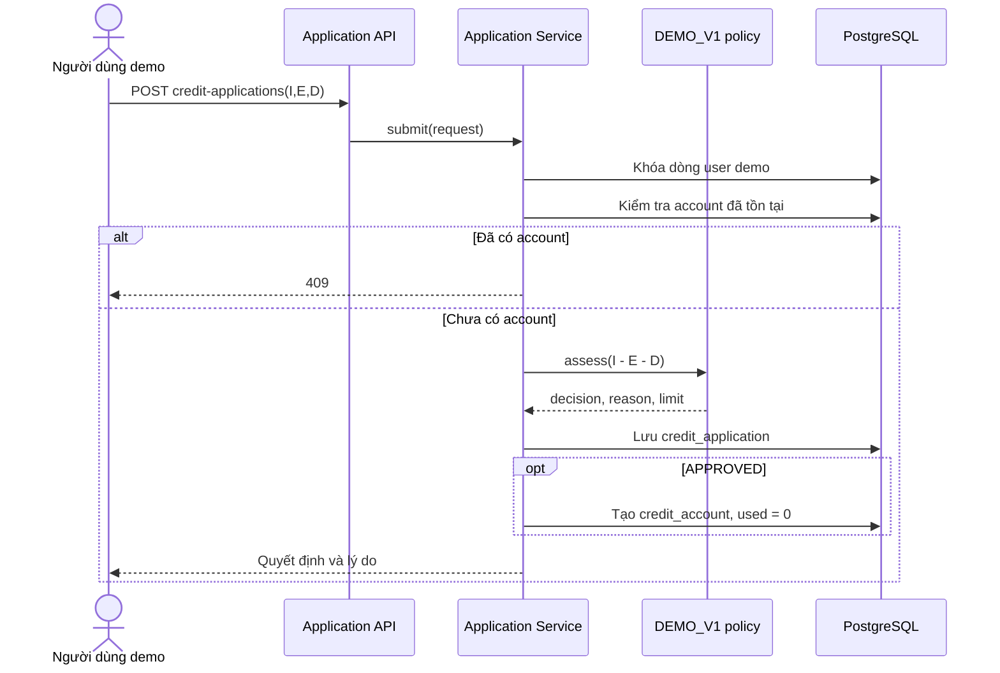
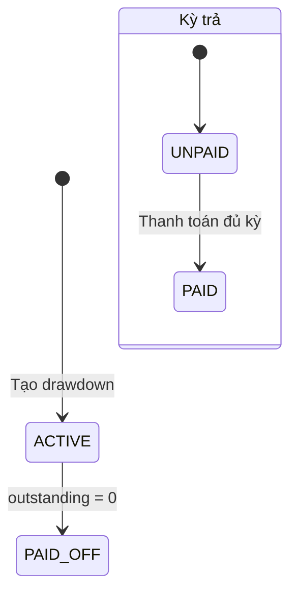

# Mini Lending MVP — phân tích nghiệp vụ

> Phạm vi: phiên bản nhỏ trước khi mở rộng, tại commit `b31088a` trên nhánh `develop`. Tài liệu này mô tả hành vi của phiên bản đó, không mô tả API hiện tại. Quy tắc tín dụng và thanh toán đều là mô phỏng.

## 1. Bài toán và ranh giới

Một người dùng demo được thẩm định theo ba số liệu tháng, nhận hạn mức SGD, sử dụng một phần hạn mức để tạo khoản nợ và trả toàn bộ từng kỳ. Mục tiêu là chứng minh vòng đời **thẩm định → cấp hạn mức → sử dụng → lập lịch → trả nợ → hoàn lại hạn mức** cùng tính nhất quán của số dư.

MVP chưa có đăng nhập, nhiều tài khoản, trả một phần, xử lý thanh toán đến trễ, quá hạn, lãi/phí, bút toán hay kết nối ngân hàng. `users` chỉ chứa một bản ghi seed; backend lấy UUID từ cấu hình `lending.demo-user-id`.

## 2. Sơ đồ ngữ cảnh



UI gọi API theo `/api`; controller kiểm tra request và chuyển việc cho service. Service đặt ranh giới transaction; JPA ghi dữ liệu vào PostgreSQL. Flyway V1 tạo sáu bảng và seed người dùng. Không có payment provider thật.

## 3. Mô hình dữ liệu



Mỗi người tối đa một `credit_account`; mỗi `drawdown` có đúng bốn kỳ do service tạo. V1 đặt `UNIQUE(instalment_id)` ở repayment, nên một kỳ chỉ có một giao dịch thành công. Khóa idempotency của drawdown độc nhất theo account; khóa repayment độc nhất toàn bảng vì MVP chỉ có một người dùng.

## 4. Thẩm định và cấp hạn mức

### Dữ liệu và quyết định

- Input: thu nhập ròng `I`, chi phí sinh hoạt `E`, nghĩa vụ nợ tháng `D`, đơn vị SGD. Cả ba không âm, tối đa hai chữ số thập phân.
- `surplus = I - E - D`. Không chặn surplus âm; giá trị đó dẫn đến từ chối.
- Policy `DEMO_V1` là bảng cố định:

|           Surplus SGD | Kết quả  | Hạn mức SGD | Mã lý do               |
| --------------------: | -------- | ----------: | ---------------------- |
|              Dưới 400 | REJECTED |           0 | `INSUFFICIENT_SURPLUS` |
|   Từ 400 đến dưới 800 | APPROVED |         500 | `APPROVED_TIER_500`    |
| Từ 800 đến dưới 1.500 | APPROVED |       1.000 | `APPROVED_TIER_1000`   |
|              Từ 1.500 | APPROVED |       2.000 | `APPROVED_TIER_2000`   |

Quyết định được tính ngay khi POST, không lưu trạng thái `SUBMITTED` chờ xử lý. Hệ thống lưu snapshot input, surplus, phiên bản policy, mã lý do, thời điểm và hạn mức. Bị từ chối thì được nộp lại; đã có account thì trả `409`, không cấp account thứ hai.



Khóa dòng user giúp hai yêu cầu thẩm định song song không cùng tạo account. Ràng buộc `UNIQUE(user_id)` ở account là lớp bảo vệ thêm.

## 5. Sử dụng hạn mức và lịch trả

`available = total_limit - used_limit`. Chỉ account `ACTIVE` được sử dụng; số tiền tối thiểu SGD 0,04 để chia ra bốn kỳ dương. Trong một transaction, service khóa dòng account, kiểm tra khả dụng, tăng `used_limit`, tạo drawdown và bốn instalment.

Ba kỳ đầu nhận `floor(amount / 4, 2 decimals)`; kỳ cuối nhận phần còn lại. Ví dụ SGD 100,01 thành `25,00 + 25,00 + 25,00 + 25,01`. Ngày hạn là ngày sử dụng cộng lần lượt 1–4 tháng theo `LocalDate.plusMonths`.

```mermaid
sequenceDiagram
    actor U as Người dùng demo
    participant A as Drawdown API
    participant S as Drawdown Service
    participant D as PostgreSQL
    U->>A: POST credit-drawdowns(amount, Idempotency-Key)
    A->>S: utilize(amount, key)
    S->>D: Khóa account PESSIMISTIC_WRITE
    S->>D: Tìm drawdown cùng account + key
    alt Key đã dùng cùng amount
        S-->>U: Trả drawdown cũ
    else Key đã dùng khác amount
        S-->>U: 409
    else Yêu cầu mới
        S->>S: Kiểm tra amount <= available
        S->>D: Tăng used; tạo drawdown và 4 instalment
        S-->>U: ID drawdown và available mới
    end
```

Hai request cùng lúc đòi SGD 700 trên hạn mức SGD 1.000 sẽ lần lượt đi qua khóa account: một request thành công, request còn lại thấy available chỉ còn SGD 300 và bị từ chối. Key trùng không tăng dư nợ hai lần.

## 6. Thanh toán đồng bộ

Chỉ kỳ `UNPAID` có `sequence_no` nhỏ nhất của **chính drawdown đó** được trả. MVP trả trọn `amount` của kỳ, không nhận số tiền tùy chọn. Request thành công ghi giao dịch `SUCCESS`, chuyển kỳ thành `PAID`, giảm outstanding của drawdown và giảm used của account trong cùng transaction. Khi outstanding bằng 0, drawdown chuyển `PAID_OFF`.



```mermaid
sequenceDiagram
    actor U as Người dùng demo
    participant A as Repayment API
    participant S as Repayment Service
    participant D as PostgreSQL
    U->>A: POST instalments/{id}/repay + key
    A->>S: repay(id, key)
    S->>D: Đọc kỳ và drawdown; khóa account
    S->>D: Refresh entity sau khi chờ khóa
    alt Cùng key và kỳ
        S-->>U: Trả kết quả cũ
    else Key xung đột hoặc sai thứ tự
        S-->>U: 409
    else Hợp lệ
        S->>D: Ghi SUCCESS; kỳ PAID
        S->>D: Giảm outstanding và used
        S-->>U: Dư nợ và available mới
    end
```

### Bất biến sau commit

```text
0 <= used_limit <= total_limit
available_limit = total_limit - used_limit
used_limit = SUM(outstanding_principal của các drawdown trong account)
original_amount của drawdown = SUM(amount của bốn kỳ)
outstanding_principal = original_amount - SUM(repayment SUCCESS)
```

Ví dụ `I/E/D = 3000/1400/500` cho surplus 1100 và limit 1000. Sử dụng 800 khiến used 800, available 200, bốn kỳ 200. Trả kỳ đầu khiến outstanding/used còn 600 và available 400. Trả hết bốn kỳ khiến used 0, available 1000.

## 7. Trade-off và hướng khác

| Quyết định MVP                         | Lợi ích trong phạm vi nhỏ           | Đổi lại / hướng xử lý khác                                                                              |
| -------------------------------------- | ----------------------------------- | ------------------------------------------------------------------------------------------------------- |
| Một user seed, không auth              | Tập trung vào hạn mức và giao dịch  | Không bảo vệ dữ liệu nhiều người; bản mở rộng dùng JWT và scope theo user.                              |
| Bảng policy cố định                    | Dễ giải thích và test ngưỡng        | Không có lịch sử tín dụng hoặc tỷ lệ nghĩa vụ nợ; có thể version policy và lưu snapshot.                |
| Thanh toán đồng bộ, chỉ SUCCESS        | Một transaction đơn giản            | Không mô phỏng kết quả đến trễ/thất bại; có thể dùng payment attempt PENDING và callback.               |
| Trả trọn một kỳ                        | Bất biến đơn giản, một giao dịch/kỳ | Không xử lý thiếu tiền hoặc quá hạn; thêm remaining amount và cho phép nhiều attempt/kỳ.                |
| Lưu used, outstanding và trạng thái kỳ | API đọc nhanh                       | Dữ liệu bị lặp về mặt kế toán; cần đối soát hoặc sổ bút toán để phát hiện lệch.                         |
| Khóa bi quan trên account              | Chặn vượt hạn mức và trả trùng      | Giảm throughput trên cùng account; khi tải cao có thể cân nhắc optimistic locking + retry có kiểm soát. |

## 8. Những gì được kiểm chứng

Test của phiên bản MVP bao phủ ngưỡng policy, chia tiền đến cent, từ chối vượt hạn mức, hai drawdown đồng thời, retry cùng key, thứ tự trả kỳ, tất toán và rollback. PostgreSQL Testcontainers được dùng để kiểm tra transaction/row lock thực, không chỉ mock repository. Tài liệu gốc: [IMPLEMENTATION_PLAN.md](IMPLEMENTATION_PLAN.md); schema: [V1\_\_credit_line_mvp.sql](backend/src/main/resources/db/migration/V1__credit_line_mvp.sql).
